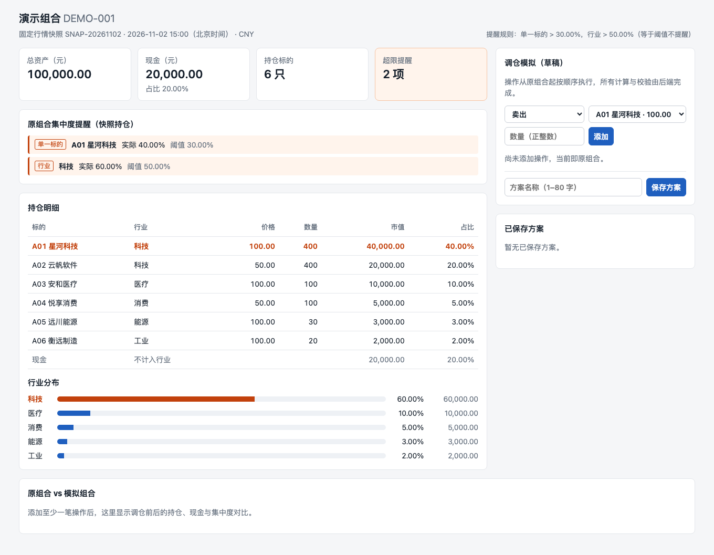
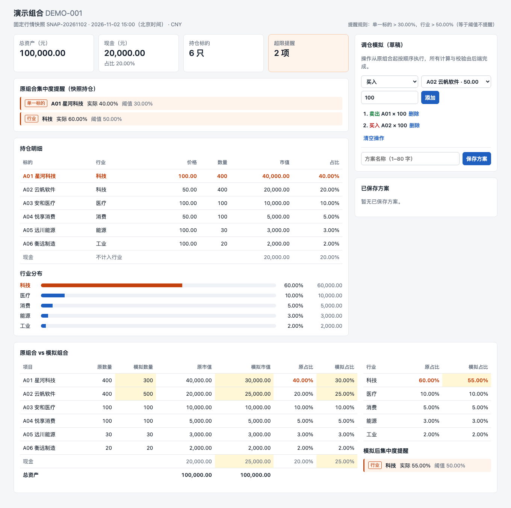
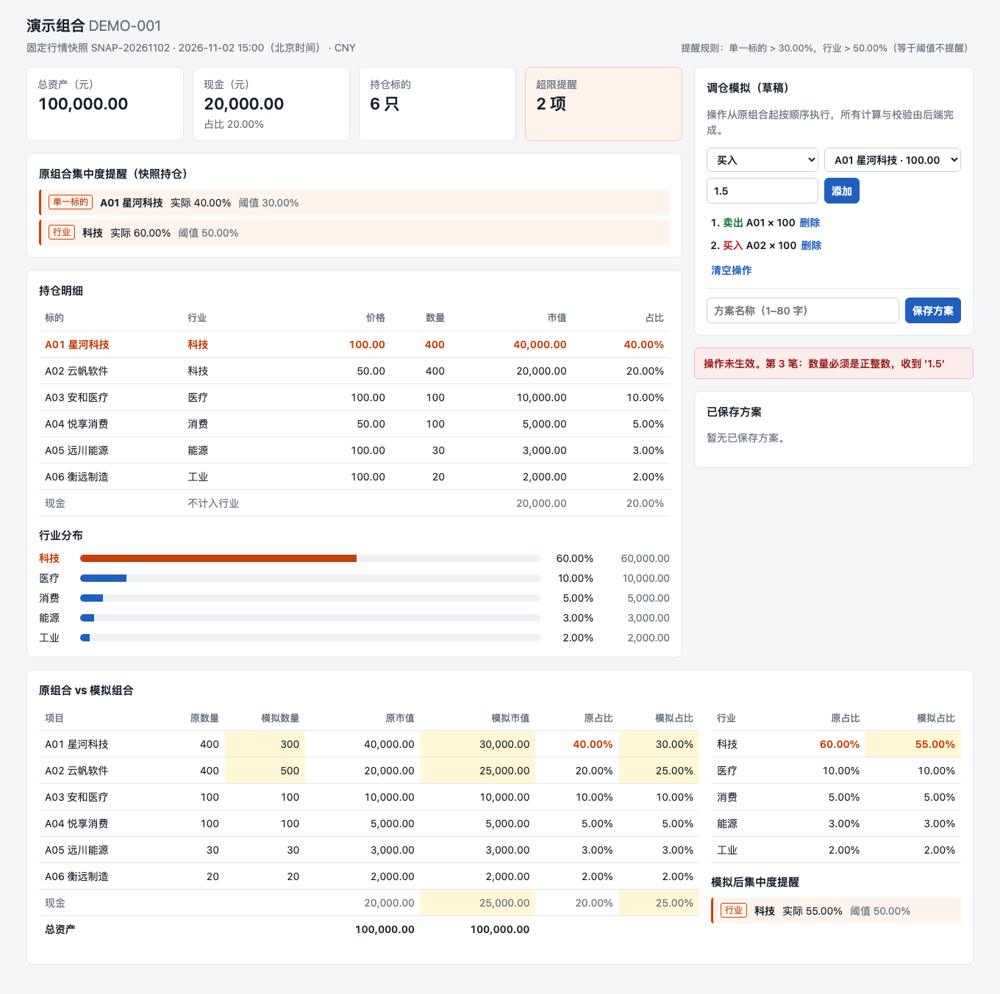
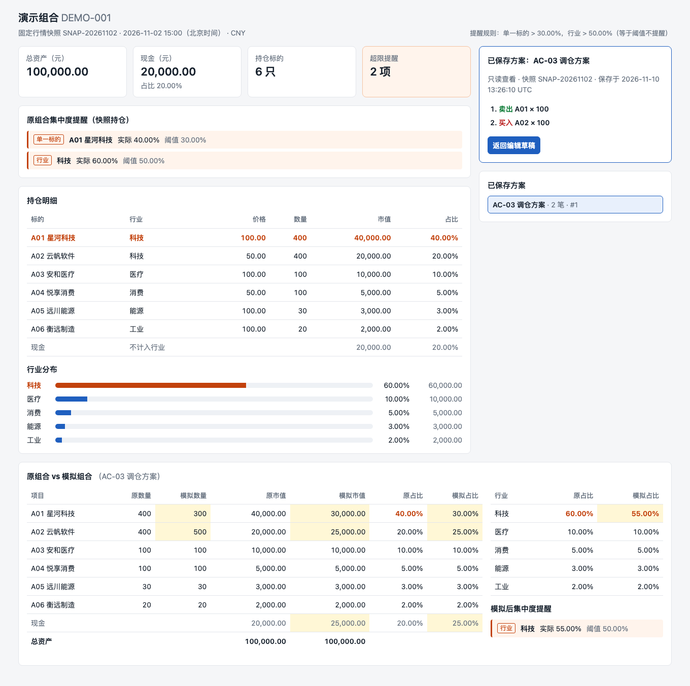

# 验证记录 VERIFY.md

验证对象：`main` @ `52ac496`（T0–T3 已合并）。环境：macOS (Apple Silicon)、Python 3.12.9（uv 0.12.23）、Node 22.22.0、Playwright Chromium headless。
验证日期：2026-11-11。下面"实际结果"都摘自本次运行的原始输出，原始输出保存在 `docs/verify/`。

## 验证方式

| 层 | 命令 | 结果 | 原始输出 |
| --- | --- | --- | --- |
| 引擎 + API + 真实重启 | `uv run --frozen pytest -v backend/tests` | 47 passed | [docs/verify/pytest.txt](docs/verify/pytest.txt) |
| 浏览器端到端（生成截图） | `cd e2e && SCREENSHOT_DIR=../docs/screenshots npx playwright test` | 3 passed | [docs/verify/e2e.txt](docs/verify/e2e.txt) |
| 干净克隆 → 安装 → 启动 → 重启 | `bash scripts/clean_install_check.sh` | CLEAN INSTALL CHECK PASSED | [docs/verify/clean-install.txt](docs/verify/clean-install.txt) |
| AC-04 后端响应原文 | TestClient 脚本 | 6 种输入全部 422，原组合不变 | [docs/verify/api-ac04.txt](docs/verify/api-ac04.txt) |
| Agent Loop 门禁 | `python3 -m unittest discover -s loop/tests -t .` | 19 passed（main 上的 T0 版本） | CI `ci.yml` |

## 验收用例

| 编号 | 步骤 | 预期 | 实际 | 是否通过 |
| --- | --- | --- | --- | --- |
| AC-01 | 打开首页 / `GET /api/portfolio` | 总资产 100,000.00，现金 20,000.00；A01 40%、科技 60% 两项提醒，其他对象不超限 | 页面显示总资产 100,000.00、现金 20,000.00；提醒正好 2 条：A01 实际 40.00% 阈值 30.00%，科技 实际 60.00% 阈值 50.00%。引擎测试断言占比精确等于 `Fraction(2,5)`、`Fraction(3,5)` | 通过 |
| AC-02 | 卖出 A01 100 | 现金 30,000，A01 市值 30,000，总资产不变；A01 30%、科技 50%，两项提醒解除 | 模拟现金 30,000.00，A01 30.00%，科技 50.00%，模拟后提醒 0 条，总资产 100,000.00。引擎断言占比精确等于 `3/10`、`1/2`，证明严格大于时等于阈值不提醒 | 通过 |
| AC-03 | 接着买入 A02 100 | 现金 25,000，A02 数量 500、市值 25,000，科技 55% 再次提醒；总资产不变 | 模拟现金 25,000.00，A02 500 股 / 25,000.00，科技 55.00%，模拟后提醒 1 条（科技），总资产 100,000.00 | 通过 |
| AC-04 | 分别从原组合：买 A01 201、卖 A01 401、数量 0 / -1 / 1.5（另测 `"5"`、`true`、`1.0`、未知标的） | 后端拒绝，错误明确，不改变有效结果 | 全部 HTTP 422，例如 `INSUFFICIENT_CASH: 第 1 笔：买入 A01 201 股需 20,100.00 元，可用现金仅 20,000.00 元`；原组合保持不变（`True`）。页面上已有两笔有效操作时，追加非法操作只显示错误，模拟现金仍为 25,000.00，操作数仍为 2 | 通过 |
| AC-05 | 保存 AC-03 方案 → 刷新 → 重启服务 → 重开 | 结果不变；原组合现金 20,000、A01 400、A02 400 | e2e：刷新后草稿清空，重开"AC-03 调仓方案"显示现金 25,000.00、A02 500。`test_restart.py` 与干净安装脚本都真实终止 uvicorn 进程后重新启动，重开响应与保存前**完全相同**；原组合现金 20000.00、A01 400、A02 400 | 通过 |

补充用例（均在 pytest 中）：恰好用完现金的买入（200 股，现金为 0）允许；多笔序列中第 3 笔失败时返回 `index: 2`；卖空某标的后该行保留并显示 0；空方案等于原组合且不可保存；方案名去空白后为空、81 字或非字符串时拒绝，正好 80 字时允许；不存在的方案返回 404；非法 JSON 与错误的请求体返回同一种错误格式；种子文件与邮件附件 SHA-256 一致。非整数路径参数（`/api/scenarios/abc` → 422 `INVALID_REQUEST`）在 T3 修复时手动验证过，没有对应的自动化用例。

## 截图

| 场景 | 文件 |
| --- | --- |
| 初始组合（AC-01，两项提醒，空方案状态） |  `docs/screenshots/01-initial.png` |
| 模拟对比（AC-03，变化高亮，模拟后行业提醒） |  `docs/screenshots/02-compare.png` |
| 错误反馈（AC-04，第 3 笔 1.5 被后端拒绝，有效结果保持） |  `docs/screenshots/03-error.png` |
| 已保存方案重开（AC-05，只读视图，原组合不变） |  `docs/screenshots/04-saved.png` |

截图由 Playwright 在 e2e 断言通过后自动截取，未经手工编辑。

## 开发过程中的门禁证据（摘要）

每个切片合并前都经过 `loop gate`：spec 锁 → 范围 → 工作区干净 → 检查命令 → Grok 只读审查。完整记录见 DESIGN.md §7。

| 运行 | 切片 | 结果 |
| --- | --- | --- |
| `.loop/runs/20261110-224651-T0-loop-7ccc68` | T0 | Grok 判定不通过，3 个阻塞问题（已修复） |
| `.loop/runs/20261110-233219-T0-loop-f8bdc6` | T0 | 通过 |
| `.loop/runs/20261110-230627-T1-engine-fb4ef3` | T1 | 通过 |
| `.loop/runs/20261110-230628-T2-api-34235b` | T2 | 通过 |
| `.loop/runs/20261111-001322-T3-frontend-92ef26` | T3 | 通过（第 2 轮） |

## 未验证 / 局限

- 只在 macOS 上实测；Linux/Windows 未运行。未做公网部署（任务书不要求），也未提供 Docker 镜像。
- e2e 只覆盖 Chromium。
- 门禁通过只说明"检查通过、审查者没有发现阻塞问题"，不等于语义完整；需求映射已在上表人工逐条核对。
